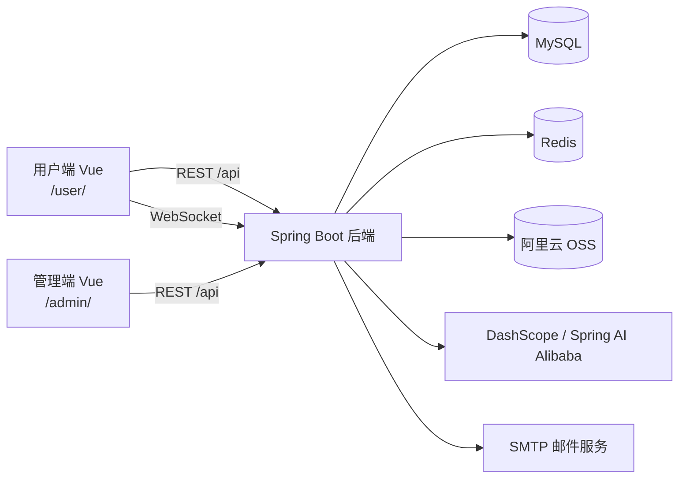

# 墨栈（Mozhan）

> 一个以“写作、记录与交流”为核心的全栈内容社区系统。  
> 支持文章发布、随笔创作、私密日记、用户关注、评论互动、实时私信、AI 助手，以及配套的内容管理后台。


## 项目简介

墨栈由三个相互协作的应用组成：

- **用户端**：面向普通用户的内容社区，提供浏览、创作、互动和聊天功能。
- **管理端**：面向管理员的运营后台，提供数据概览和内容治理能力。
- **后端服务**：基于 Spring Boot 的 REST API、WebSocket 服务和 AI 能力服务。

项目采用“纸张与墨色”的视觉主题，用户端和管理端共享一套设计语言，适合作为个人博客、创作社区或全栈项目实践的基础。

## 功能特性

### 用户端

- 用户注册、登录、JWT 身份认证与个人资料维护
- 用户主页、关注与取消关注、关注列表和粉丝列表
- 文章浏览、Markdown 编辑、草稿保存、发布、编辑、删除和置顶
- 文章分类、标签、热门内容和关键词搜索
- 文章点赞、评论、回复和评论管理
- 随笔发布、编辑、删除和个人随笔列表
- 私密日记的创建、编辑、删除和查看
- 日记内容使用 AES-256 加密存储
- 用户之间的实时私信、未读消息、已读和消息撤回
- 图片、头像上传，并支持接入阿里云 OSS
- 邮箱验证码能力
- AI 助手对话
- AI 辅助写作：生成大纲、文章、标题/摘要等，并支持流式输出

### 管理端

- 数据概览与趋势图表
- 用户管理和用户状态维护
- 文章、随笔、评论管理
- 分类和标签管理
- 管理员登录与权限校验

## 技术栈

### 后端

- Java 21
- Spring Boot 3.5
- Spring Web / WebSocket / Mail
- MyBatis-Plus
- MySQL
- Redis
- JWT
- Lombok、Hutool
- 阿里云 OSS
- Spring AI Alibaba + DashScope
- Maven

### 用户端

- Vue 3
- Vite
- Vue Router
- Pinia
- Element Plus
- Ant Design Vue
- Axios
- Vditor Markdown 编辑器
- marked
- lucide-vue-next

### 管理端

- Vue 3
- Vite
- Vue Router
- Element Plus
- ECharts
- Axios

## 项目结构

```text
mozhan/
├── mozhan/                 # Spring Boot 后端
│   ├── src/main/java/      # Controller、Service、Mapper、领域模型等
│   ├── src/main/resources/ # application 配置、MyBatis XML、AI Prompt
│   ├── doc/                # API 接口文档
│   └── pom.xml
├── mozhan-web/             # 用户端 Vue 应用
│   ├── src/views/article/  # 文章页面
│   ├── src/views/essay/    # 随笔页面
│   ├── src/views/diary/    # 日记页面
│   ├── src/views/chat/     # 私信与 AI 页面
│   ├── src/api/            # 前端 API 封装
│   └── package.json
└── mozhan-system/          # 管理端 Vue 应用
    ├── src/views/admin/    # 后台管理页面
    ├── src/components/     # 后台公共组件
    └── package.json
```

## 系统架构



## 环境要求

| 工具 | 版本建议 |
| --- | --- |
| JDK | 21+ |
| Maven | 3.9+ |
| Node.js | 20+ |
| npm | 10+ |
| MySQL | 8.x |
| Redis | 7.x |

## 本地运行

### 1. 准备数据库和 Redis

创建项目数据库：

```sql
CREATE DATABASE mo_zhan
  DEFAULT CHARACTER SET utf8mb4
  COLLATE utf8mb4_unicode_ci;
```

启动 MySQL 和 Redis，并准备与项目实体、Mapper 对应的表结构。当前仓库未提供独立的数据库初始化 SQL 文件，请根据实际部署环境导入已有表结构或补充初始化脚本。

### 2. 配置后端

后端配置位于：

- `mozhan/src/main/resources/application.yaml`
- `mozhan/src/main/resources/application-local.yaml`
- `mozhan/src/main/resources/application-dev.yaml`

配置内容包括：

- MySQL 连接信息
- Redis 连接信息
- JWT 密钥
- 日记 AES-256 密钥
- 阿里云 OSS
- SMTP 邮箱
- DashScope API Key 和模型

推荐通过环境变量注入敏感配置，再启动对应 profile：

```powershell
cd mozhan
mvn spring-boot:run "-Dspring-boot.run.profiles=local"
```

默认后端地址为 `http://localhost:8080`。

### 3. 启动用户端

```powershell
cd mozhan-web
npm install
npm run dev
```

用户端开发地址通常为：

```text
http://localhost:5173/user/
```

Vite 已配置 `/api` 代理到 `http://localhost:8080`，并支持 WebSocket 代理。

### 4. 启动管理端

```powershell
cd mozhan-system
npm install
npm run dev
```

管理端开发地址：

```text
http://localhost:5174/admin/
```

## 构建部署

分别构建两个前端：

```powershell
cd mozhan-web
npm run build

cd ../mozhan-system
npm run build
```

构建产物默认位于各自项目的 `dist/` 目录。

构建后需要保证 Web 服务器能够正确处理以下路径：

- 用户端：`/user/`
- 管理端：`/admin/`
- 后端 API：`/api/`
- WebSocket：`/api/chatServer`

如果使用 Nginx 或其他反向代理，请将 `/api` 转发到 Spring Boot 服务，并开启 WebSocket Upgrade。

## API 文档

完整接口说明见：

[API 接口文档](./mozhan/doc/API接口文档.md)

接口统一使用 JSON 响应格式，并通过 `Authorization: Bearer <token>` 传递登录凭证。

## 开发约定

- 用户端路由基础路径为 `/user/`
- 管理端路由基础路径为 `/admin/`
- 前端开发环境通过 Vite 将 `/api` 代理到后端
- 私信通过 WebSocket 通道 `/api/chatServer` 实时通信
- AI 对话和 AI 写作接口使用流式响应
- 日记密钥必须稳定保存，生产环境不要使用仓库中的默认值

## 当前状态

项目已具备完整的用户端、管理端和后端业务骨架，核心内容发布、互动、私信、AI 与后台管理功能均已接入，适合继续完善测试、数据库初始化脚本、部署配置和权限细化。

